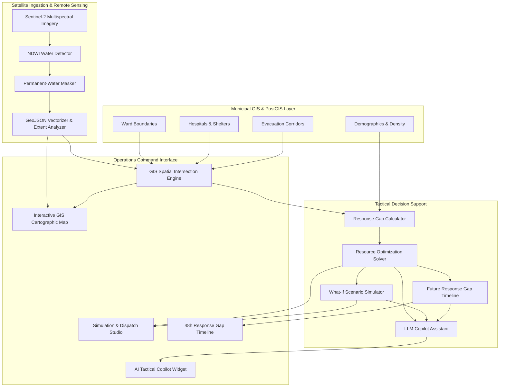

# RAKSHAK-GEO // CityShield GIS

> **AI-Powered Satellite Flood Intelligence, Spatial Impact Analytics & Emergency Resource Optimization Platform**

[](https://fastapi.tiangolo.com)
[](https://python.org)
[](https://astro.build)
[](https://react.dev)
[](https://tailwindcss.com)
[]()

---

## Executive Overview

**RAKSHAK-GEO** (CityShield GIS) is an integrated emergency operations command and decision-support system built for municipal disaster management authorities. Designed with a pilot deployment focusing on the **Ahmedabad Municipal Corporation / Sabarmati River Basin**, the system bridges the gap between raw remote-sensing satellite observations, municipal GIS infrastructure databases, and frontline emergency logistics dispatch.

The platform continuously processes multispectral satellite imagery, isolates floodwater extent, intersects inundation vectors against urban administrative wards and critical infrastructure, computes mathematical resource gaps, and computes optimized, priority-weighted dispatch orders for rescue and relief teams.

---

## Core Capabilities & Engines

### 1. Satellite Remote Sensing & Flood Detection
- **GeoTIFF Raster Ingestion**: Ingests Sentinel-2 multispectral surface reflectance bands using `rasterio` and `pyproj`.
- **NDWI Water Detection**: Implements McFeeters Normalized Difference Water Index formula:
  $$\text{NDWI} = \frac{\text{Green} - \text{NIR}}{\text{Green} + \text{NIR}}$$
- **Permanent-Water Masking**: Performs deterministic spatial subtraction of permanent water baselines (rivers, reservoirs, permanent lakes) to isolate *new* potential surface floodwater.
- **Quantitative Extent Analyzer & GeoJSON Vectorization**: Analyzes cluster connectivity (4/8 connectivity), calculates ellipsoidal geodesic surface area ($\text{km}^2$), and exports RFC 7946 GeoJSON `FeatureCollection` representations.

### 2. City GIS Spatial Intelligence
- **Vector Spatial Intersections**: Evaluates 2D planar intersections between polygon flood extents and administrative ward boundaries.
- **Critical Facility Exposure**: Identifies inundated hospitals, medical centers, emergency evacuation shelters, and compromised road corridors.
- **Inundation Classification**: Categorizes ward inundation levels into discrete operational tiers: `UNAFFECTED`, `LOW`, `MODERATE`, `HIGH`, and `CRITICAL`.

### 3. Multi-Criteria Resource Optimization Engine (T-014)
- **Deterministic Solver**: Solves resource allocation dilemmas under acute scarcity without stochastic jitter.
- **Resource Classes**:
  - Advanced Life Support (ALS) Ambulances
  - Inflatable Rescue Boats
  - Trauma Medical Kits
  - Emergency Ration Food Packs
  - Personnel & Emergency Responders
- **Strict Invariants**: Enforces non-negativity, depot capacity constraints, demand caps, and equitable priority weighting.

### 4. What-If Tactical Scenario Simulator (T-015)
- **Real-Time Dynamic Simulation**: Allows emergency operators to test operational assumptions before committing physical assets.
- **Scenario Customization**:
  - Stockpile overrides and mutual aid influxes
  - Local hospital and clinic capacity destruction or reinforcement
  - Evacuation demand surges and priority overrides
- **Delta Impact Metrics**: Computes exact zone-by-zone before-and-after variance in fulfillment rates and unmet deficits.

### 5. Future Response Gap Timeline Engine (T-016)
- **Multi-Horizon Projections**: Models projected resource deficits across 0h, 6h, 12h, 18h, 24h, and 48h operational horizons.
- **Bottleneck Prevention**: Early identification of secondary deficits (e.g., medical supply depletion after initial water recession).

### 6. AI Emergency Copilot (T-020)
- **Operational LLM Assistant**: Context-aware assistant integrated into the command center providing real-time synthesis, scenario explanations, and tactical protocol guidance.
- **Context Injection**: Automatically incorporates active dashboard metrics, optimization dispatches, or timeline forecasts.
- **Offline Fallback**: Seamless graceful degradation when external API connectivity is offline.

---

## System Architecture



---

## Tech Stack

| Domain | Technology / Library | Purpose |
| :--- | :--- | :--- |
| **Backend Framework** | FastAPI (Python 3.10+) | High-performance asynchronous REST API |
| **Geospatial & Rasters** | Rasterio, PyProj, Shapely | Satellite raster processing & vector spatial analytics |
| **Spatial Database** | PostgreSQL / PostGIS | Geospatial database with GiST spatial indexes |
| **Security & Middleware**| Starlette, Pydantic v2 | Strict schema validation, rate-limiting, and CSP headers |
| **LLM & AI Engine** | Google Gemini API / google.genai | Conversational decision-support copilot |
| **Frontend Framework** | Astro 5 + React 19 | Fast static site generation with interactive island hydration |
| **GIS Cartography** | Leaflet.js | Client-side map rendering with ISRO Bhuvan WMS integration |
| **Styling & System** | Tailwind CSS v4 | Clean, professional, high-contrast command dashboard |
| **Testing & Quality** | Pytest, AnyIO | 178 automated unit, integration, and security tests |

---

## Project Structure

```text
RAKSHAK-GEO/
├── backend/
│   ├── app/
│   │   ├── api/v1/              # Versioned API routes & endpoints
│   │   │   ├── endpoints/       # Optimization, What-If, Timeline, GIS, Copilot
│   │   │   └── router.py        # Central API v1 router
│   │   ├── core/                # Settings, environment configuration, constants
│   │   ├── db/                  # PostGIS connection session & init SQL migrations
│   │   ├── schemas/             # Pydantic request & response validation schemas
│   │   ├── services/            # Core business logic & algorithmic engines
│   │   └── main.py              # FastAPI application entrypoint & security middleware
│   ├── tests/                   # Comprehensive pytest test suite (178 tests)
│   └── requirements.txt         # Python runtime dependencies
├── frontend/
│   ├── src/
│   │   ├── components/          # React command center components
│   │   │   ├── CommandHeader.tsx
│   │   │   ├── CopilotChat.tsx
│   │   │   ├── Dashboard.tsx
│   │   │   ├── GISMap.tsx
│   │   │   ├── IncidentSelector.tsx
│   │   │   ├── OperationalStatsRow.tsx
│   │   │   ├── Simulation.tsx
│   │   │   ├── Timeline.tsx
│   │   │   └── ZoneDetailPanel.tsx
│   │   ├── layouts/             # Astro base layouts
│   │   ├── pages/               # Multi-page views (Dashboard, Simulation, Timeline)
│   │   ├── lib/                 # Typed API client, models, and mock datasets
│   │   └── styles/              # Global Tailwind CSS definitions
│   ├── astro.config.mjs         # Astro configuration & React integration
│   └── package.json             # Frontend dependencies & scripts
├── data/
│   └── city/                    # Ahmedabad ward boundaries, facilities, and seed data
├── CURRENT_STATE.md             # Active operational state & verified test logs
├── DESIGN.md                    # Detailed design system specifications
├── TASK_BOARD.md                # Engineering backlog & task tracking
└── README.md                    # Project documentation
```

---

## Getting Started

### Prerequisites

- **Python**: 3.10 or newer
- **Node.js**: v18.0.0 or newer (v22+ recommended)
- **Git**

---

### Backend Setup

1. **Navigate to the backend directory**:
   ```bash
   cd backend
   ```

2. **Create and activate a virtual environment**:
   ```bash
   # On macOS / Linux
   python3 -m venv .venv
   source .venv/bin/activate

   # On Windows (PowerShell)
   python -m venv .venv
   .\.venv\Scripts\Activate.ps1
   ```

3. **Install dependencies**:
   ```bash
   pip install -r requirements.txt
   ```

4. **Configure environment variables**:
   Create a `.env` file in `backend/` (or copy from `.env.example` in repository root):
   ```ini
   PROJECT_NAME="CITYSHIELD GIS - RAKSHAK-GEO"
   API_V1_STR="/api/v1"
   ENVIRONMENT="development"
   GEMINI_API_KEY="your-gemini-api-key"   # Optional: runs in fallback mode without it
   ```

5. **Start the FastAPI backend server**:
   ```bash
   uvicorn app.main:app --host 127.0.0.1 --port 8000 --reload
   ```

   The API will be available at:
   - **Service Root**: `http://127.0.0.1:8000`
   - **Health Check**: `http://127.0.0.1:8000/api/health`
   - **Interactive Swagger Docs**: `http://127.0.0.1:8000/api/v1/docs`

---

### Frontend Setup

1. **Navigate to the frontend directory**:
   ```bash
   cd frontend
   ```

2. **Install dependencies**:
   ```bash
   npm install
   ```

3. **Run the development server**:
   ```bash
   npm run dev
   ```

   Or build and serve static production output:
   ```bash
   npm run build
   npx serve -s dist -l 4321
   ```

   Access the interactive command center at: **`http://localhost:4321`**

---

## API Reference

| Method | Endpoint | Description |
| :--- | :--- | :--- |
| `GET` | `/api/health` | Service health status and readiness check |
| `POST`| `/api/v1/optimization/allocate` | Priority-weighted resource allocation solver |
| `POST`| `/api/v1/what-if/simulate` | Comparative What-If scenario simulation |
| `POST`| `/api/v1/future-gap/timeline` | Multi-horizon future response gap timeline |
| `POST`| `/api/v1/gis/impact` | 2D vector spatial inundation analysis |
| `POST`| `/api/v1/flood-response/analyze`| End-to-end flood-to-dispatch pipeline execution |
| `POST`| `/api/v1/copilot/chat` | AI Copilot conversational tactical guidance |
| `GET` | `/api/v1/city-data/wards` | Administrative ward polygons and demographic metrics |
| `GET` | `/api/v1/city-data/hospitals` | Hospital facilities and bed capacity status |
| `GET` | `/api/v1/city-data/shelters` | Relief shelter locations, occupancy, and generator status |
| `GET` | `/api/v1/gis/isro/wms` | Secure proxy for ISRO Bhuvan satellite basemap tiles |

---

## Test Suite Execution

The repository maintains an automated test suite verifying mathematical invariants, raster handling, geodetic geometry calculations, and API security.

Run the test suite from the `backend/` directory:

```bash
pytest
```

**Results: 178 / 178 Passed (0 Failures)**
- `test_copilot.py`: Copilot service, context injection, and schema fallback tests
- `test_response_gap_timeline.py`: Chronological ordering, timeline policies, and extent integrations
- `test_flood_extent.py`: Geodesic ellipsoidal area computation and polygon extraction
- `test_permanent_water_masker.py`: Surface water baseline subtraction
- `test_ndwi_water_detector.py`: McFeeters NDWI spectral index verification
- `test_raster_ingestion.py`: GeoTIFF georeferencing and CRS preservation
- `test_optimization_engine.py`: Scarcity allocation and priority weight solvers
- `test_what_if_engine.py`: Baseline vs. scenario delta comparison calculations
- `test_timeline_engine.py`: Multi-horizon planning projections
- `test_gis_impact.py`: Shapely vector spatial intersections
- `test_security_hardening.py`: CSP headers, payload size limits, and sanitization

---

## License & Operational Notice

This platform was developed as an advanced emergency operations command prototype. All satellite test fixtures and simulated disaster resource stockpiles are explicitly tagged as **DEMO DATA** unless connected to live municipal PostGIS and authorized telemetry feeds.
